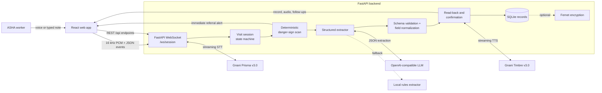
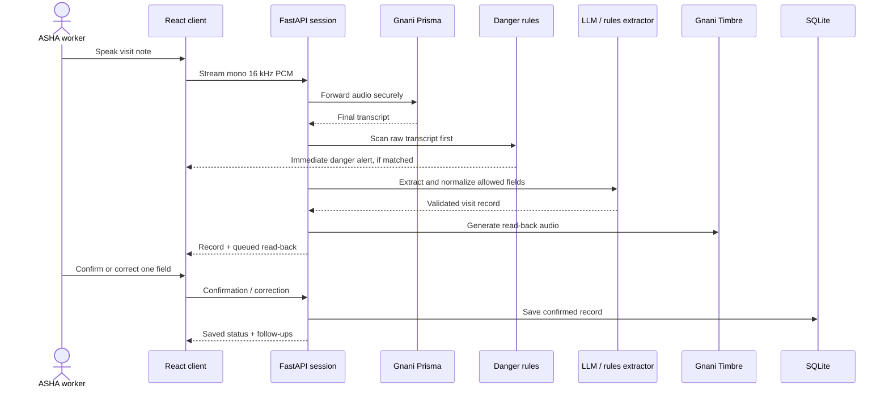

# SwarVani

SwarVani is a voice-first visit-register prototype for ASHA workers. It accepts synthetic visit notes, extracts a fixed visit schema, checks phrases against a deterministic danger-sign list, reads the record back for confirmation, and saves confirmed visits with follow-ups.

## What it does

- Captures Hindi, Hinglish, and English visit notes through the microphone or text input.
- Converts spoken names, IDs, measurements, blood pressure, haemoglobin, and dates into structured fields.
- Checks every transcript against deterministic danger-sign rules before model extraction.
- Reads the completed record back, accepts field-level corrections, and saves only after confirmation.
- Maintains a follow-up board and supports transcript purging while retaining structured records.
- Queues assistant speech to prevent overlapping replies and provides a mute control.

## System architecture



API credentials remain on the backend. The browser communicates only with SwarVani's HTTP and WebSocket endpoints.

## Voice-processing flow



## Tech stack

| Layer | Technology | Purpose |
| --- | --- | --- |
| Frontend | React 19 + TypeScript 5.8 | Responsive visit workflow and structured record UI |
| Styling | Tailwind CSS 4 | Mobile-first design system and accessible status states |
| Build tooling | Vite 7 | Development server, production bundling, and API/WebSocket proxying |
| Backend | Python 3.11+ + FastAPI | REST API, WebSocket endpoint, validation, and orchestration |
| Application server | Uvicorn | ASGI server for HTTP and persistent WebSocket connections |
| Speech-to-text | Gnani Prisma v3.0 | Streaming Hindi/code-mixed transcription |
| Text-to-speech | Gnani Timbre v3.0 | Streaming assistant read-back audio |
| Structured extraction | OpenAI-compatible chat-completions API | JSON extraction into the fixed visit schema |
| Offline fallback | Deterministic Python extractor | Names, spoken numbers, IDs, measurements, dates, and corrections |
| Safety layer | Deterministic phrase matcher + JSON catalog | Danger-sign detection independent of the LLM |
| Storage | SQLite | Confirmed visit records and follow-up data |
| Encryption | `cryptography` / Fernet | Optional encryption of stored record payloads |
| Backend networking | HTTPX + `websockets` | LLM HTTP calls and Gnani streaming connections |
| Production proxy | NGINX | Static frontend hosting plus `/api` and `/ws` reverse proxying |
| Containers | Docker + Docker Compose | Reproducible frontend/backend deployment and persistent storage |
| Verification | Python `unittest`, smoke checks, TypeScript compiler | Session, API, safety, storage, and production-build checks |

### Voice and AI services

- **STT:** Gnani Prisma v3.0 through a backend WebSocket. The browser streams mono 16 kHz PCM to FastAPI; the API key stays on the backend.
- **TTS:** Gnani Timbre v3.0 through its realtime WebSocket endpoint.
- **LLM:** OpenAI-compatible endpoint, selected with `LLM_BASE_URL`, `LLM_API_KEY`, and `LLM_MODEL`. Qwen is the example default; it is not required.
- **Orchestration:** custom FastAPI session state machine. No telephony, phone numbers, or hosted end-to-end agent platform.
- **Safety:** deterministic phrase matcher runs before LLM extraction; it does not diagnose or give treatment advice.

The demo mode uses browser speech recognition and the local rules extractor. It avoids external model calls so the interface can be tried before credentials are configured.

## Repository structure

```text
SwarVani/
├── frontend/
│   ├── src/
│   │   ├── components/       # Visit form, danger alert, landing page, icons
│   │   └── lib/              # WebSocket session hook and shared types
│   ├── nginx.conf            # Production reverse proxy
│   ├── vite.config.ts        # Local /api and /ws proxies
│   └── Dockerfile
├── backend/
│   ├── app/
│   │   ├── main.py           # FastAPI REST + WebSocket entrypoint
│   │   ├── pipeline.py       # Visit-session state machine
│   │   ├── extract.py        # LLM and deterministic extraction
│   │   ├── normalization.py  # Spoken-number and Hindi-name normalization
│   │   ├── danger_signs.py   # Deterministic safety matcher
│   │   ├── gnani.py          # Prisma and Timbre adapters
│   │   ├── db.py             # SQLite and Fernet storage
│   │   └── schemas.py        # Visit-record schema
│   ├── scripts/              # Smoke and regression checks
│   ├── .env.example
│   └── Dockerfile
├── docker-compose.yml
└── README.md
```

## Run locally on Windows

1. Install Python 3.11 or newer and Node.js 20 or newer.
2. In one PowerShell terminal:

   ```powershell
   cd backend
   py -m venv .venv
   .\.venv\Scripts\Activate.ps1
   pip install -r requirements.txt
   if (!(Test-Path .env)) { Copy-Item .env.example .env }
   python -m uvicorn app.main:app --reload --port 8000
   ```

3. In a second terminal:

   ```powershell
   cd frontend
   npm install
   npm run dev
   ```

4. Open the Vite URL shown in the frontend terminal (normally `http://localhost:5173`). The frontend proxies `/api` and `/ws` to the local FastAPI service.

## Run with Docker Compose

If `backend/.env` does not exist, copy `backend/.env.example` to that name, then start the stack:

```powershell
docker compose up --build
```

Open `http://localhost:8080`. NGINX serves the built frontend and proxies API and WebSocket traffic to FastAPI. SQLite data persists in a Docker volume. Configure the Gnani and LLM environment values in `backend/.env` before switching to live mode.

## Enable the required Gnani models

Create an API key in the Gnani API Platform. In `backend/.env`, set:

```dotenv
SV_DEMO_MODE=false
GNANI_API_KEY=your_key
GNANI_LANGUAGE=hi-IN
GNANI_TTS_VOICE=Shivani
```

The default endpoint values in `.env.example` point to Gnani Prisma v3.0 and Timbre v3.0 streaming endpoints. Keep the key private and never put it in a `VITE_` variable or frontend file. Use a browser served over HTTPS when testing microphone access outside localhost.

## Choose an LLM

Set an OpenAI-compatible chat-completions base URL, key, and model in `backend/.env`:

```dotenv
LLM_BASE_URL=https://your-provider.example/v1
LLM_API_KEY=your_key
LLM_MODEL=your-structured-output-model
```

The extractor requests JSON and validates values against the visit schema. If the LLM settings are blank or the provider returns an error, it falls back to the local rules extractor. Danger-sign detection never depends on the LLM.

## Storage and transcript retention

SQLite is stored under `backend/.data/` by default. Generate an encryption key and set it as `SV_DB_KEY` before using non-demo configurations:

```powershell
cd backend
python -c "from cryptography.fernet import Fernet; print(Fernet.generate_key().decode())"
```

The `/api/health` response reports whether database encryption is enabled. `/api/purge-transcripts` removes stored transcript text while retaining structured records. Trigger it after the judging period if transcript retention is no longer needed. Use synthetic data only; this prototype is not approved for real patient information or clinical decisions.

## Guideline references for the prototype matcher

The phrase list is a software prototype based on these public NHM/MoHFW materials. It requires review by a qualified health authority before any field use:

- [ASHA Training Module 7, Newborn Health, p. 55](https://hbnc-hbyc.mohfw.gov.in/assets/document/ASHA_Training_Module_7.pdf)
- [Comprehensive Emergency Obstetric and Newborn Care Curriculum 2024, Part 2, p. 70](https://nhm.gov.in/images/pdf/programmes/maternal-health/guidelines/Revised_CEmONC_curriculum_2024-Part_2.pdf)
- [NHM Pregnancy Care, p. 238](https://www.nhm.gov.in/images/pdf/guidelines/nrhm-guidelines/stg/pregnancy-care.pdf)

## Build and run the flow check

```powershell
cd frontend
npm run build
cd ..\backend
python -m scripts.smoke
python -m unittest scripts.test_regressions -v
```

## Deployment notes

### Deploy the frontend with GitHub Pages

1. Push the source and `.github/workflows/pages.yml` to the repository's `main` branch. Review it through a pull request if needed. The workflow publishes on pushes to `main` and can also be run from the **Actions** tab.
2. Deploy the backend on Render using the settings below. Use a fresh demo database with synthetic data. Set `SV_ALLOWED_ORIGINS=https://ayushjha9999999.github.io` for this repository. The browser origin excludes the `/SwarVani/` path.
3. In GitHub, select **Settings → Pages → Build and deployment → Source → GitHub Actions**. Under **Settings → Secrets and variables → Actions → Variables**, create the repository variable `VITE_API_BASE` with the Render HTTPS origin, such as `https://swarvani-api.onrender.com`. This is a public build setting. Keep secret keys on Render.
4. In **Actions**, run **Deploy SwarVani to GitHub Pages** on `main`. Use the URL from the deploy job to test the landing video, a sample visit, and the follow-up board. The workflow uses the Pages base path when building media and frontend assets.

### Deploy a demo with Vercel and Render

Push the version you want to deploy to GitHub, including any local changes you want online. Git ignores `backend/.env` and the local database. The site is a prototype with a local worker profile rather than authenticated access. Start with a fresh database and use synthetic visit data only.

1. In [Render](https://dashboard.render.com/), create a **Web Service** from your GitHub repo. Select the branch you want to deploy and set the root directory to `backend`. Use the **Python** runtime, build command `pip install -r requirements.txt`, start command `python -m uvicorn app.main:app --host 0.0.0.0 --port "$PORT"`, and health check path `/api/health`. Set `SV_DEMO_MODE=true` for browser speech, rule-based extraction, and the WhatsApp simulator. Copy the HTTPS service URL once its health check passes.
2. In [Vercel](https://vercel.com/new), import the same repo and branch. Set **Root Directory** to `frontend`. Set the frontend build variable `VITE_API_BASE` to the Render HTTPS origin (for example, `https://swarvani-api.onrender.com`). The Vercel configuration in `frontend/vercel.json` builds the Vite app into `dist`.
3. In Render, set `SV_ALLOWED_ORIGINS` to the exact deployed Vercel origin (for example, `https://swarvani.vercel.app`). Multiple known origins can be comma-separated. Check the deployed site by sending a sample visit note, confirming it, opening Follow-ups, and simulating a WhatsApp reply. The browser connects to Render directly over HTTPS and WSS.

Render's default filesystem is ephemeral. For saved demo visits to survive restarts, attach a persistent disk to a paid service and set `SV_DB_PATH` to a database file within the disk mount directory. Set `SV_DB_KEY` to a new Fernet key on the backend if enabling encryption, and keep that key stable for the same database.

For Netlify, use the same Render backend. Import the repository with base directory `frontend`, build command `npm run build`, and publish directory `dist`. Set the same `VITE_API_BASE` build variable and add the Netlify origin to the backend's allowed origins.

Keep Gnani, LLM, Meta, and database credentials in backend environment variables. Browser demo mode works without those integrations. Live provider setup is separate, and the demo's local-only WhatsApp test sender is intended for localhost.
